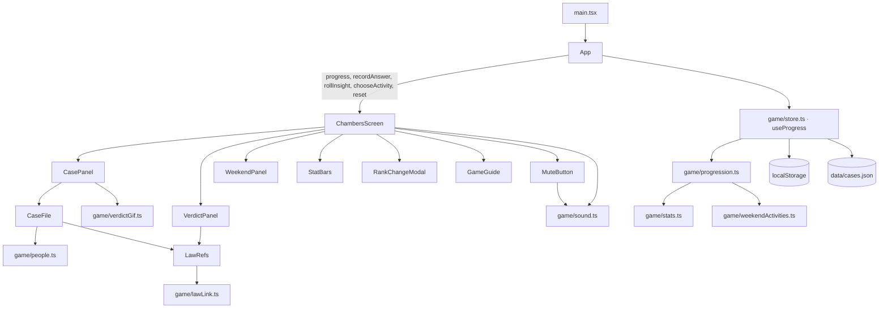

# 대법관 키우기 — 프로젝트 정리

> 실제 한국 하급심 판례를 읽고 **법원이 실제로 내린 판결(형량·청구 결과)**을 맞히며
> 배석판사에서 대법원장까지 올라가는 웹 게임.
> 정리 기준일: 2026-11-16

## 1. 개요

| 항목 | 내용 |
|---|---|
| 화면 | React 19 + TypeScript, Vite 6, 단일 화면(집무실/재판장) |
| 데이터 검증 | zod (`src/types/case.ts`) |
| 사건 생성 | 국가법령정보센터 Open API로 판례 수집 → Gemini(`gemini-3.8-flash`)로 게임 문제 변환 |
| 저장 | 브라우저 localStorage (서버 없음) |
| 사건 수 | 140건 — 형사 89 · 민사 51, 난이도 1/2/3 = 35/63/42, **전부 미검수**(`reviewed:false`, `data:build -- --all`로 포함) |

```bash
npm run dev      # 개발 서버
npm run build    # 타입 검사 + 빌드 (dist/)
```

API 키는 `.env`(git 미추적)에만 둔다. 문서·코드에 값 기재 금지.

---

## 2. 게임 흐름 트리 (플레이어 관점)

```
게임 시작 (1주차 월요일, 배석판사, 능력치 모두 60)
│
├─ 집무실 (헤더: "집무실")
│   ├─ [평일, 기습 일정이 있는 날] 기습 이벤트 창 → 참여한다 / 거절한다 → 결과 → 확인
│   │     (한 주에 1~2번, 답하기 전엔 사건 배당 불가, 표: docs/EVENTS.md)
│   ├─ [평일 월~금] 사건 배당받기  ─ 보류한 사건이 있으면 "보류한 사건 다시 보기"
│   └─ [주말 토·일] 주말 활동 고르기 ─ ▶ 주말 흐름
│
├─ 재판장 (헤더: "재판장")
│   ├─ 사건 기록철 (탭 3개)
│   │   ├─ 사건개요: 당사자 줄(인물 그림 · 이름 · 역할 · 한 줄 설명) + 핵심 사실 3~4개
│   │   ├─ 증거목록: 증거 2~3개
│   │   └─ 쟁점: 핵심 쟁점 + 관련 조문 링크(국가법령정보센터, 새 탭)
│   ├─ 질문: "B를 폭행한 A에게 어떤 형을 선고할까요?" / "A의 청구에 대해 어떻게 판결할까요?"
│   ├─ 보기: 형사 4개(무죄·벌금·집행유예·실형 계열) / 민사 3개(기각·일부 인정·전부 인정)
│   │
│   ├─ [집무실로 돌아가기] → 사건 보류 → 다음 배당 때 같은 사건 그대로
│   │
│   └─ [판결 선고]
│       ├─ 오답 + 이번 사건에서 처음 → 통찰력 판정
│       │   └─ 발동: 판사봉 소리 없이 "선고 직전, 날카로운 통찰력으로 판단을 다시 돌아볼 기회를 얻었습니다."
│       │           고른 오답은 막히고 다시 선택 (사건당 1회)
│       └─ 확정
│           ├─ 판사봉 소리
│           ├─ 고른 보기 칸 안 오른쪽: 인물 gif(판결성공/실패) + 적중/미적중 도장
│           ├─ 보기 표시: 정답 = 초록, 내가 고른 오답 = 빨강
│           ├─ 진급·강등 판정
│           │   ├─ 적중
│           │   │   ├─ 필요 적중 수 도달 → 진급 (평판: 두 단계 진급 확률)
│           │   │   └─ 미도달 → 평판: 조기 진급 확률
│           │   └─ 미적중
│           │       └─ 이 직급에서 2번째 오답 → 인맥: 강등 면제 확률, 실패 시 강등
│           ├─ 능력치 발동 안내 (담백한 한 문장)
│           ├─ 직급 변경 모달 (진급/강등 시)
│           ├─ 판결문: 법원·선고일·사건번호 / 주문 / 해설 / 판결문 중에서 / 관련 조문 / 원문 링크
│           ├─ 건강 −1, 다음 요일로
│           └─ [집무실로 돌아가기] 하나뿐 (하루 1건: 반드시 집무실을 거쳐 다음 날로)
│
├─ 주말 흐름
│   ├─ 토요일: 선택지 4개(통찰력·인맥·평판·건강 활동 각 1개) 중 1개 → 주 능력치 +8, 다른 능력치 −4
│   ├─ 일요일: 토요일에 나온 활동 제외하고 새 4개 중 1개 (토요일 결과 한 줄 표시)
│   ├─ 건강 40 미만이면 건강 활동 4개만 제시
│   └─ 일요일 선택 후 → 다음 주차 월요일
│
├─ 대법원장 도달 → 엔딩 ("대법원장 취임")
└─ 60세가 되는 인사 시점에 대법원장이 아니면 → 엔딩 ("정년 퇴임")
```

### 직급표

| # | 직급 | 진급 필요 적중 수 | 출제 난이도(우선순) | 강등 |
|---|---|---|---|---|
| 0 | 배석판사 | 3 | 1 | 없음 |
| 1 | 단독판사 | 3 | 1, 2 | 오답 2회 |
| 2 | 부장판사 | 4 | 1, 2 | 오답 2회 |
| 3 | 수석부장판사 | 4 | 2, 1 | 오답 2회 |
| 4 | 지방법원장 | 5 | 2, 3 | 오답 2회 |
| 5 | 고등법원장 | 6 | 2, 3 | 오답 2회 |
| 6 | 대법관 | 7 | 3, 2 | 오답 2회 |
| 7 | 대법원장 | — (게임 종료) | — | — |

직급이 바뀌면 그 직급의 적중/오답 수는 0으로 초기화. 출제 순서: 해당 난이도의 안 푼 사건 → 안 푼 사건 전체 → 틀린 사건 → 전체.

---

## 3. 기능 스토리 트리

✅ 완료 · ⏸ 보류 · ⬜ 할 일

### 에픽 A. 사건 데이터
- ✅ **판례 수집** — 하급심 형사·민사 판례를 Open API로 수집 (`data:fetch`)
  - 주문에 형량(형사) 또는 지급액·청구기각(민사)이 분명한 판결만
  - 제외: 대법원·항소기각처럼 형량 없는 주문, 애매한 주문(피고인 여럿·일부 무죄·반소 등), 민사 항소심·가사, **성범죄**, 3건 이상 병합, 부가처분, 중복 사건번호
  - 사망 사건 등 나머지 소재는 모두 허용
- ✅ **게임 문제 변환** — Gemini가 원문을 문제 형식으로 (`data:convert`)
  - 사건개요는 짧게: 핵심 사실 3~4문장, 당사자 설명 20자, 증거 2~3개
  - 사람·단체 이름은 A·B·C만, 앞의 수식어("집주인 B")와 뒤의 "씨·회사" 제거
  - 쟁점에 구체적 형 이름(집행유예·실형·사형·벌금·무죄 등) 금지, "형량·처벌" 같은 일반 단어는 허용
  - 질문은 플레이어가 직접 판결하는 형식 ("당신이라면…", "법원은 ~했을까" 금지)
  - 보기: 형사 4개(형량만), 민사 3개 고정(기각/일부 인정/전부 인정, 금액 안 씀)
- ✅ **정답 위치 쏠림 보정** — 형사 정답 위치 무작위화, 무죄는 항상 1번 (`data:rebalance`)
- ⛔ **난이도 상대평가** — 전체를 비교해 다시 매기는 방식은 사용 중지 (2026-11-16). 새 사건 난이도는 변환 때 매긴 값 사용
- ✅ **검증** — 스키마, 정답과 주문 일치, 결론 누설, 쟁점 형 이름, 질문체, 이름 수식어, 인물 그림 중복 (`data:validate`)
- ✅ **관련 조문 링크** — 조문 주소 자동 생성, 폐지·개명 법령은 실제로 열어 보고 검색 링크로 대체 (`data:laws`)
- ✅ 사건 10건 추가 (2026-11-16, 형사 6·민사 4 → 총 110건). 기존 100건 난이도는 유지
- ✅ 사건 30건 추가 (2026-11-17, 형사 19·민사 11 → 총 140건). Flash-Lite 변환이 당사자 이름에 실명·"원고"를 넣는 등 규칙을 자주 어겨 손으로 고침 → 검증에 "당사자 이름은 알파벳" 오류 추가
- ⬜ 사건 더 추가 (시드 키워드 확장해 둠)
- ⬜ 사건 검수 (`reviewed:true`)
- ⏸ 간결화 이전의 긴 사건개요: 남아 있지 않음. 필요하면 `data/raw` 원문에서 재생성

### 에픽 B. 사건 풀이 화면
- ✅ 사건 기록철 탭 3개: 사건개요(당사자 탭 통합) · 증거목록 · 쟁점
- ✅ **자세한 개요 보기** (2026-11-16): 사건개요 아래 버튼으로 펼침. 판결문에서 6~10문장으로 경위·양쪽 주장을 정리(`backgroundDetail`, `npm run data:details`). 이번 판결 결과와 재판부의 판단("법원은 ~라고 보았습니다")은 걸러 냄(1심 결과·과거 전과·지난 소송은 허용)
- ✅ 사건개요 첫머리에 당사자 한 줄씩: 인물 그림 · 이름 · 역할 · 설명
- ✅ **당사자 인물 그림 배정** — API 없이 규칙으로 (`data:avatars`)
  - 설명·사건개요·해설의 단서(남편·딸·할머니·대학생·은퇴 등)로 나이대(20/40/60/80)·성별 추정
  - 한 사건 안에서 같은 그림 두 번 금지, 민사는 persona와 일치
  - 오판은 `data/avatar-overrides.json`(15건)으로 수동 보정
- ✅ 증거목록 이모지 제거
- ✅ 선고 전 "집무실로 돌아가기" → 사건 보류, 재배당 시 같은 사건
- ✅ 사건 배당 중 헤더 "집무실" → "재판장"
- ⬜ 인물 그림 성별·나이 편중(40·60대 남성 위주): 단서 없는 당사자 분산 여부 미정

### 에픽 C. 선고 연출
- ✅ 판사봉 소리 (볼륨 0.2), 통찰력 발동 시에는 소리 없음
- ✅ 결과 표시 위치 변천: 큰 배너 → 한 줄 배너 → 판결문 첫 줄 → **고른 보기 칸 안 오른쪽**(현재)
  - "실제 판결: ~" 문구 삭제 (보기의 정답 표시로 대신)
  - 판사봉 그림 삭제, 도장 문구 "적중/미적중"
  - gif 36px, 보기 칸 높이 변하지 않게 고정
  - 선고 직후 고른 보기가 화면 가운데 오도록 스크롤
- ✅ 인물 gif: 민사·형사 공통 (민사 = persona, 형사 = 피고인 그림과 같은 나이대·성별), 적중 = 판결성공, 미적중 = 판결실패
- ⏸ 형사 전용 gif 에셋 (사용자가 나중에 제공)

### 에픽 D. 진급·강등
- ✅ 직급 8개, 직급별 출제 난이도 (직급표 참고)
- ✅ 진급: 직급별 필요 적중 수 3·3·4·4·5·6·7건 (2026-11-16, 대법원장까지 32건) / 강등: 같은 직급에서 오답 2회 (배석판사는 강등 없음)
- ✅ **법관 경력의 시간** (2026-11-16): 판결 4건마다 1년 + 처음 오르는 직급으로 진급할 때 1년 (강등, 강등 뒤 원래 직급을 되찾는 진급은 시간 없음)
  - 30세 임관 → 전부 적중하면 판결 32건, 45세(법관 16년차)에 대법원장
  - 60세가 되었는데 대법원장이 아니면 정년 퇴임 → "정년 퇴임" 엔딩 (오르내리면 대략 판결 55~60건에 정년)
  - 진급 모달: "단독판사로 진급해 … 발령받았습니다."(몇 년 뒤 표시 없음) / 인생 기록: "법관 N년차에 단독판사로 진급해 ○○지방법원 형사 제5단독으로 발령받았습니다." / 강등은 "좌천되어 … 발령받았습니다."
  - 화면에 주차·요일을 쓰지 않음: 상단 바 "직급 · 2031년 · 법관 6년차", 경력 지도는 네모 격자(한 칸 = 판결 1건), 인생 기록은 연차 머리글만
- ✅ 직급 변경 모달, 대법원장 엔딩

### 에픽 E. 능력치 · 주간 진행
- ✅ 능력치 4개: 통찰력 · 인맥 · 평판 · 건강 (0~100, 시작 60, 건강만 70 — 2026-11-16)
- ✅ 판결 적중 시 통찰력 +1, 틀려도 감소 없음 (2026-11-17)
- ✅ 확률 발동: 60에서 0%, 100에서 최대, 그 사이 직선

  | 능력치 | 효과 | 100일 때 확률 |
  |---|---|---|
  | 통찰력 | 오답 선고 시 다시 고르기 (사건당 1회) | 50% |
  | 인맥 | 강등 면제 (다음 오답에서 다시 판정) | 30% |
  | 평판 | 적중 수 미달이어도 진급 | 15% |
  | 평판 | 적중 수 채워 진급할 때 두 단계 진급 | 5% |
  | 건강 | 50 미만: 모든 발동 확률 절반 / 40 미만: 주말에 건강 활동만 | — |

- ✅ 평일(월~금) 판결 1건씩, 판결마다 건강 −1 (주 −5)
- ✅ 주말(토·일) 하루 1회 활동 선택, 4지선다(능력치별 1개)
- ✅ 활동 효과 고정: 주 능력치 +8, 다른 능력치 하나 −4 (깎이는 능력치는 활동마다 다르고 설명에 이유가 드러남)
- ✅ 활동 52개, 일부는 직급 조건

  | 올리는 능력치 | 개수 | 직급 조건 활동 (최소 직급 #) |
  |---|---|---|
  | 통찰력 | 14 | 원로 법관 찾아뵙기(1), 배석판사 판결문 첨삭(2), 해외 법원 연수(3), 사법정책 세미나 발제(4), 전원합의체 판례 예습(5) |
  | 인맥 | 16 | 후배 판사 멘토링(1), 법원장 주재 골프 모임(2), 인사위원 오찬(3), 전국 법원장 간담회(4), 국회의원 초청 만찬(5), 대법원장 공관 만찬(6) |
  | 평판 | 14 | 언론 인터뷰(1), 법원 개방 행사 진행(3), 국정감사 출석(4), 신년 기자회견(5), 대국민 사법 신뢰 담화(6) |
  | 건강 | 8 | 관사 정원 가꾸기(4) |

- ✅ 발동 안내는 자연스러운 한 문장 ("평소 좋은 평판을 쌓아 2계급 특진을 했습니다.", "두터운 인맥 덕분에 강등을 면했습니다.")
- ✅ **기습 이벤트** (2026-11-16): 사건 3건 동안 최대 1번(바퀴마다 60%), 사건 배당 전에 이벤트 하나에 참여/거절
  - 일반 32개: 참여 주 능력치 +6·다른 능력치 −3, 거절 변화 없음 또는 −3
  - 유혹 12개(청탁·접대·정당 영입·입각 타진 등): 참여 +8·평판 −6, 25% 확률로 들통 평판 −6 추가
  - 직급별 등장, 4주 반복 방지, 건강 40 미만이면 건강이 깎이는 이벤트 제외
  - 전체 표: [EVENTS.md](EVENTS.md) (`npm run docs:events`로 코드에서 생성)
- ✅ 판결 후 [다음 사건] 제거 → 반드시 집무실로 돌아감
- ✅ **진행 단위 변경** (2026-11-16): 월~금 판결·토일 활동(주 단위) → **사건 3건마다 활동 1번**. "주말"이라는 말은 쓰지 않고 "활동 선택". 예전 저장본은 열 때 바퀴 단위로 맞춤
- ✅ 인생 기록에는 능력치 변화를 남기지 않음 (2026-11-16): 기습 이벤트는 "[참여] 독감 걸린 동료 대신 당직을 섰습니다."처럼 무슨 일이었는지 문장만, 활동은 "[활동] 판례 스터디 모임"
- ✅ 인생 기록 순서: 날짜 묶음과 같은 날 안의 기록 모두 최근 것이 위 (기습 일정 → 판결 → 진급 순이면 진급이 맨 위)
- ⬜ 알려진 허점: 사건을 보류했다가 다시 열면 통찰력 판정을 한 번 더 받을 수 있음

### 에픽 F. 편의 · 화면
- ✅ 대시보드 배치 (2026-11-16): 상단 바(직급·주차·대법원장까지 진행 바·음소거) + PC 3단(본문 폭 1440px, 왼쪽 360 / 가운데 / 오른쪽 380, 남는 폭은 좌우 여백), 1100px 미만은 한 줄(오늘의 재판 → 신분증 → 상태 → 기록), 좁은 화면에서 재판 중엔 오른쪽 기록 칸 숨김
- ✅ 판사 이름 (2026-11-17): 신분증 "이름" 줄을 눌러 정함(최대 8자), 저장·처음부터 다시 해도 유지, 엔딩 문장에 사용
- ✅ 캐릭터 성별 (2026-11-16): 신분증 위쪽 띠의 [남|여]로 언제든 전환, 직급 그림(신분증·직급표·진급 창)이 바뀜. Progress.gender에 저장(기본 여), 처음부터 다시 해도 유지
- ✅ 법관 신분증 카드: 직급 그림·직급·근무처(직급별 무작위)·근무 주차·진급/오판 현황 (Lv 표시·"강등 없음" 문구 없음)
- ✅ 경력 지도: 한 줄 10칸 네모 격자, 판결 1건 = 1칸 (적중 초록·미적중 빨강, 진급/강등 마름모, 나머지는 빈 네모, 최근 100건)
- ✅ 인생 기록: 집무실의 오늘의 재판(주말 활동) 바로 아래, 날짜별 최근 순 타임라인 — 판결 적중/미적중 꼬리표 + 사건명만(내 판결·정답은 남기지 않음, 2026-11-17), 능력치 발동, 진급/강등, 기습 일정([일정] 꼬리표 + 참여·거절 문장), 유혹 제안 수락·거절과 들통, 주말 활동. 재판 중에는 숨김
- ✅ 기습 일정이 있어도 그날 판결은 그대로 진행(이벤트에 답한 뒤 사건 배당), 경력 지도에는 기습 일정 표시 안 함
- ✅ 업적 45개 (2026-11-17): 해금 팝업(인생 기록에는 안 남김), 상태 카드 아래 업적판(한 줄 3개, 기본 12개 + 펼치기, 얻은 업적 먼저), 기록 초기화해도 이 브라우저에 유지·재해금 없음. 목록 [ACHIEVEMENTS.md](ACHIEVEMENTS.md), 뱃지 프롬프트 [BADGE_PROMPTS.md](BADGE_PROMPTS.md) (`npm run docs:badges`), 그림 변환 `npm run assets:badges` (img/badges/<id>.png → src/assets/badges/<id>.webp)
- ✅ 활동 카드 (2026-11-17): 위쪽 색 띠 없음, 능력치 변화 표시는 각진 사각형, 오르는 쪽은 그 능력치 색(내리는 쪽은 빨강), 테두리와 설명글 시작 위치 맞춤, 활동명 크게
- ⬜ 2단계: 연수원 동기들(가상 경쟁자), 이름 입력, 법원 사람들 / 3단계: 법률 용어 사전, 근무지 장면 그림, 판결 메모
- ✅ 상태 카드: 능력치 막대 + 판결·적중·적중률
- ✅ 능력치 막대 4개 (건강 낮으면 색 경고)
- ✅ 게임 안내 (형사/민사 설명 줄은 삭제)
- ✅ 상단 음소거 버튼 (브라우저에 기억)
- ✅ 기록 초기화
- ⏸ 배경음악
- ⬜ 선택: 버튼 스타일, PC 2단 레이아웃, "판결문 중에서" 접기

---

## 4. 아키텍처

### 4.1 디렉터리

```
supreme-justice/
├─ src/
│  ├─ main.tsx                 진입점, 전역 CSS 로드
│  ├─ App.tsx                  useProgress → ChambersScreen 연결
│  ├─ screens/
│  │  └─ ChambersScreen.tsx    유일한 화면: 헤더·프로필·사건/주말/엔딩 전환, 보류 사건, 스크롤
│  ├─ components/
│  │  ├─ CasePanel.tsx         질문·보기·선고 버튼, 선고 후 보기 안 gif+도장
│  │  ├─ CaseFile.tsx          사건 기록철 탭 3개 (당사자 줄 포함)
│  │  ├─ VerdictPanel.tsx      판결문(주문·해설·인용·조문·원문), 집무실로 돌아가기
│  │  ├─ WeekendPanel.tsx      주말 활동 4지선다
│  │  ├─ StatBars.tsx          능력치 막대
│  │  ├─ RankChangeModal.tsx   진급·강등 모달
│  │  ├─ LawRefs.tsx           관련 조문 링크 목록
│  │  ├─ GameGuide.tsx         게임 안내
│  │  ├─ MuteButton.tsx        음소거 토글
│  │  ├─ JudgeCard.tsx         법관 신분증 카드
│  │  ├─ CareerMap.tsx         경력 지도 (주×요일 칸)
│  │  ├─ CaseLog.tsx           인생 기록 타임라인 (집무실 가운데)
│  │  ├─ SurpriseModal.tsx     평일 기습 이벤트 창 (참여/거절)
│  │  └─ StatGuide.tsx         상태 설명 (여닫이)
│  ├─ game/                    (화면과 분리된 로직)
│  │  ├─ store.ts              useProgress 훅, localStorage 저장, pickNextCase
│  │  ├─ progression.ts        applyResult(판결 반영) · applyActivity(주말) · 요일/주차
│  │  ├─ stats.ts              능력치 상수, chance/rollEffect
│  │  ├─ weekendActivities.ts  활동 52개, pickWeekendChoices
│  │  ├─ surpriseEvents.ts     기습 이벤트 44개, scheduleWeek · pickSurprise · surpriseEffects
│  │  ├─ posts.ts              직급별 근무처 무작위 배정
│  │  ├─ rankNames.ts          직급 이름 (스크립트용)
│  │  ├─ korean.ts             조사 '으로/로'
│  │  ├─ ranks.ts              직급 8개 + 그림 + 출제 난이도
│  │  ├─ verdictGif.ts         casePersona, verdictGif
│  │  ├─ people.ts             당사자 인물 그림 경로
│  │  ├─ lawLink.ts            "형법 제347조" → 국가법령정보센터 주소
│  │  └─ sound.ts              판사봉 소리, 음소거 상태
│  ├─ types/case.ts            Case / Persona zod 스키마
│  ├─ data/
│  │  ├─ cases.json            게임에 쓰는 사건 (data:build 산출물)
│  │  └─ law-no-article.json   조문 페이지 없는 법령 (data:laws 산출물)
│  ├─ styles/                  theme · game · chambers · weekly · layout(대시보드 배치) .css
│  └─ assets/                  characters/ people/ verdict/ gavel.webp sfx/gavel.mp3
├─ scripts/                    데이터·에셋 파이프라인 (tsx로 실행)
├─ data/
│  ├─ raw/                     수집한 판례 원문 (data:fetch)
│  ├─ drafts/                  변환된 문제 초안 (data:convert …)
│  ├─ seeds.json               수집 키워드
│  └─ avatar-overrides.json    인물 그림 수동 보정
├─ gif/  img/                  원본 그림·gif (scripts/process-*로 가공)
└─ docs/PROJECT.md             이 문서
```

### 4.2 런타임 구조



- **순수 로직**(`progression.ts`, `stats.ts`, `weekendActivities.ts`)은 React와 무관하고 난수(`rand`)를 인자로 받아 테스트 가능.
- `recordAnswer` → `applyResult`: 진급/강등 판정 → 건강 −1 → 다음 요일 → 토요일이면 주말 선택지 생성.
- `chooseActivity` → `applyActivity`: 효과 적용 → 토→일 새 선택지 / 일→다음 주 월요일(이번 주 기습 이벤트 요일 `scheduleWeek`).
- 평일로 넘어갈 때 `arriveWeekday`: 오늘이 기습 요일이면 `pickSurprise`로 이벤트 설정 → `answerSurprise` → `applySurprise`(유혹 이벤트 들통 판정).
- `rollInsight`: 통찰력 판정만 (진행 상태는 바꾸지 않음). 화면이 사건당 1회로 제한.

### 4.3 저장 (localStorage)

| 키 | 내용 |
|---|---|
| `supreme-justice:v1` | Progress — rankIndex, gender(male/female), name, levelCorrect, levelWrong, solved{사건id: 고른 보기·적중}, correct, total, stats, week, day(0 월 … 6 일), weekendOffer, weekendDone, lastActivity, log[](판결 기록, 최근 500개), post(근무처), surpriseDays(이번 주 남은 이벤트 요일), surprise(답하지 않은 오늘 이벤트), surpriseSeen(이벤트별 마지막 주차) |
| `supreme-justice:pending` | 보류한 사건의 id (선고 전 돌아간 경우) |
| `supreme-justice:muted` | 음소거 여부 |
| `supreme-justice:achievements` | 해금한 업적 (기록 초기화와 무관하게 유지) |

### 4.4 데이터 모델 (`Case`)

| 필드 | 설명 |
|---|---|
| id, caseNumber, court, decisionDate, sourceUrl | 판례 식별·출처 |
| category | 형사 / 민사 |
| topic, title, difficulty(1~3) | 분류·제목·난이도 |
| parties[] | role, name(A·B·C), description, age(20/40/60/80), gender — 인물 그림 |
| background[] | 핵심 사실 (2~8개, 실제 3~4개) |
| backgroundDetail[]? | 자세한 개요 (6~10문장, 결론 없음) |
| evidence[] | name, description |
| keyIssue, lawRefs[] | 쟁점, 관련 조문 |
| question, choices[](형사 4·민사 3), answerId | 문제 |
| orderText, ruling, explanation | 주문 원문, 판결 이유 인용, 해설 |
| persona? | 민사 결과 gif 인물 (형사는 피고인 그림으로 대체) |
| reviewed | 검수 여부 |

### 4.5 데이터 파이프라인

```
data:fetch ──▶ data/raw/<id>.json
   │  (Open API, seeds.json 키워드, 주문 필터: scripts/lib.ts classifyOrder)
   ▼
data:convert ──▶ data/drafts/<id>.json   (Gemini 변환 + 수식어 제거 + 질문체 변환
   │                                       + 민사 persona + 인물 그림 배정)
   ▼
data:rebalance   형사 정답 위치 무작위화 (새 사건만 --only)
   ▼
data:validate    오류 있으면 실패, 경고는 통과
   ▼
data:build -- --all ──▶ src/data/cases.json
   ▼
data:laws ──▶ src/data/law-no-article.json

보조: data:persona (민사 persona만 다시), data:avatars (인물 그림만 다시, --force), data:details (자세한 개요, 없는 사건만; --only/--force)
Gemini 모델: .env 의 GEMINI_MODEL (표기 이름 "Gemini 3.1 Flash-Lite"여도 scripts/lib.ts geminiModel()이 API ID로 바꿈)
난이도: 변환(data:convert) 때 매긴 값을 그대로 씀. 전체 재평가(scripts/rank-difficulty.ts)는 사용 중지
문서: docs:events → docs/EVENTS.md (기습 이벤트·주말 활동 표)
```

### 4.6 에셋 처리

| 스크립트 | 원본 → 결과 |
|---|---|
| `process-characters.ts` (`assets:characters`) | `img/<성별><직급>.png` (예: 남성배석판사.png) → `src/assets/characters/<male 또는 female>-<rankId>.webp` (원본 없는 성별은 건너뜀) |
| `process-people.ts` | `img/<나이>대<남\|녀>.png` → `src/assets/people/<나이><m\|f>.webp` |
| `process-verdict-gifs.ts` | `gif/<나이>대<남\|녀> 판결성공\|실패.gif` → `src/assets/verdict/<나이><m\|f>-<win\|lose>.webp` |
| `process-gavel.ts` | `gif/판사봉.gif` → `src/assets/gavel.webp` (현재 화면에서 미사용) |

배경 제거는 가장자리에서 flood-fill 해 바깥과 이어진 배경색만 투명화한다(옷의 흰색은 보존). 판사봉 소리는 루트의 `판사봉 소리.MP3`를 `src/assets/sfx/gavel.mp3`로 복사해 쓴다.
